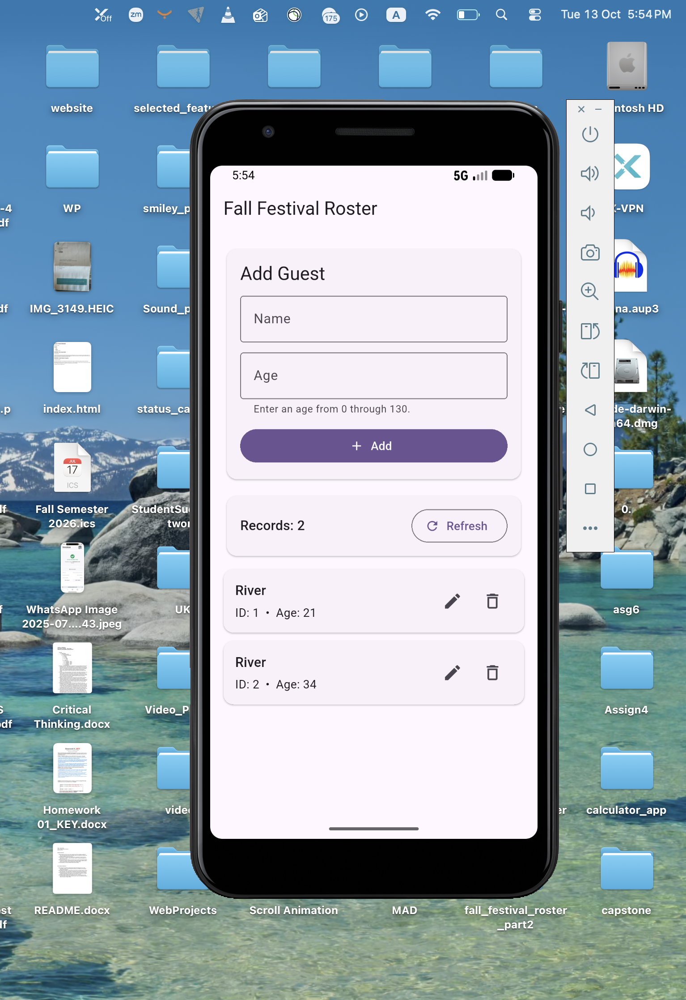
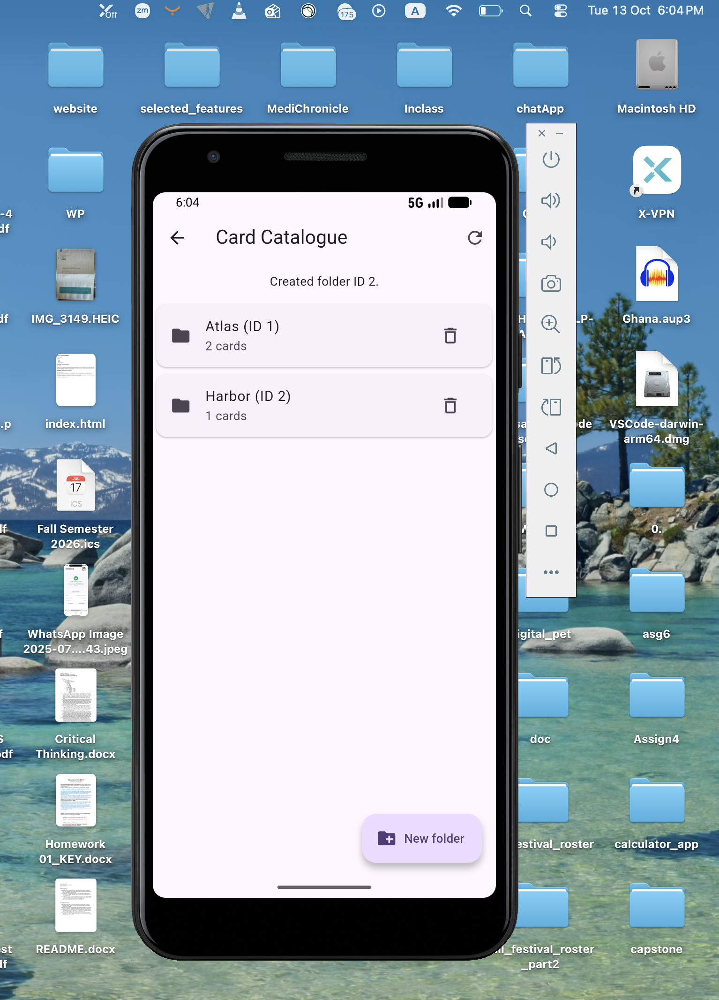
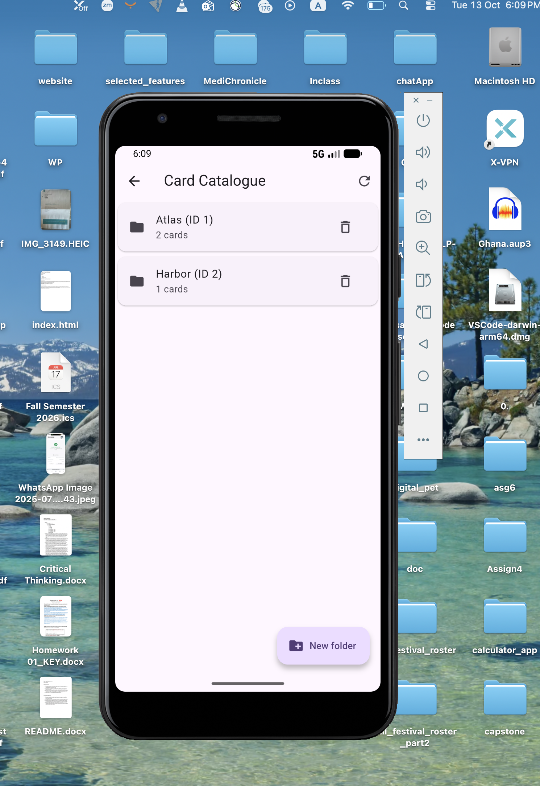

# Local Storage Part II – Connect the Pieces

**Name:** Isaac Owusu  
**Course:** CSC 6360 – Mobile App Development  
**Project:** Fall Festival Roster – Part II  
**Platform:** Flutter / Dart / SQLite

## Project Overview

This project extends my Part I Flutter application by adding a card catalogue with folders and cards. The application uses SQLite to store data locally, so records remain available after closing and reopening the app. In Part II, I upgraded the database from version 1 to version 2 while preserving the original guest records. I also added a parent-child relationship between folders and cards, including foreign key constraints and cascade deletion.

## Features

- Create and delete folders.
- Add, view, edit, and delete cards inside folders.
- Display the number of cards in each folder.
- Validate required fields before saving.
- Prevent duplicate folder names.
- Confirm deletions before removing records.
- Automatically delete child cards when their parent folder is deleted.
- Display a fallback suit symbol when a card has no usable image.
- Preserve the original Part I guest roster.
- Store records locally using SQLite.

## Technologies Used

- Flutter and Dart
- SQLite (`sqflite`)
- `path_provider`
- `path`
- Material Design widgets

## Project Structure

    fall_festival_roster_part2/
    ├── lib/
    │   ├── main.dart
    │   ├── database_helper.dart
    │   ├── catalogue_repository.dart
    │   ├── catalogue_screen.dart
    │   └── models/
    │       └── catalogue_models.dart
    ├── evidence/
    │   ├── T1_before.png
    │   ├── T2_cards.png
    │   └── T4_after.png
    ├── android/
    ├── pubspec.yaml
    └── README.md

The `evidence` folder contains screenshots captured during testing.

## Database Design

The application uses three SQLite tables.

### 1. Guest Roster (`my_table`)

This table comes from Part I and stores the original guest records.

| Column | Type | Description |
|--------|------|-------------|
| `_id` | INTEGER | Primary key |
| `name` | TEXT | Guest name |
| `age` | INTEGER | Guest age |

### 2. Folders (`folders`)

This table stores the parent folders.

| Column | Type | Description |
|--------|------|-------------|
| `id` | INTEGER | Primary key |
| `name` | TEXT | Unique folder name |
| `created_at` | TEXT | Creation timestamp |

### 3. Cards (`cards`)

This table stores cards belonging to folders.

| Column | Type | Description |
|--------|------|-------------|
| `id` | INTEGER | Primary key |
| `title` | TEXT | Card title |
| `suit` | TEXT | Card suit |
| `notes` | TEXT | Optional notes |
| `image_ref` | TEXT | Optional image URL |
| `folder_id` | INTEGER | Foreign key referencing folders |

The relationship between folders and cards is one-to-many. Each folder can contain multiple cards, but each card belongs to one folder. The `folder_id` column uses `ON DELETE CASCADE`, which removes associated cards when their parent folder is deleted. An index on `cards.folder_id` helps SQLite find cards belonging to a particular folder.

## Database Migration

Part I used database version 1. In Part II, I changed the database version to 2 and added an `onUpgrade` callback. When an existing version 1 database is opened, the upgrade creates the new `folders` and `cards` tables while leaving the original `my_table` unchanged. For a fresh installation, the `onCreate` callback creates all three tables.

Foreign key enforcement is enabled using:

    PRAGMA foreign_keys = ON;

The database continues to use the original filename:

    MyDatabase.db

This allows the application to access the existing Part I database when installed as an update using the same Android application ID and signing identity. I also used `IF NOT EXISTS` when creating the new tables and index to prevent errors if they already exist.

## Validation

The application validates user input before saving it.

- Folder names cannot be empty.
- Folder names must be unique.
- Card titles cannot be empty.
- Card suits are selected from the available options.
- Notes and image URLs are optional.
- Missing or unavailable card images use a fallback suit symbol.

The application also uses confirmation dialogs before deleting cards or folders.

## Testing

I manually tested the application to verify database migration, CRUD operations, persistence, validation, and cascade deletion.

### T1 – Database Migration

**Goal:** Verify that upgrading from version 1 to version 2 preserves the original guest records.

**Steps:**

1. Open the Part I application and record the existing guest data.
2. Capture the original records.
3. Install and launch the Part II update.
4. Open the Part I Guest Roster screen.
5. Compare the guest records and IDs with the original data.
6. Check the database version and foreign key settings.

**Result: PASS**

The database was upgraded to version 2, and foreign key enforcement was enabled. The original guest records and IDs remained unchanged. The new folders and cards tables were also available.

**Screenshot:**

### T2 – Folder and Card Creation

**Goal:** Verify that folders and cards can be created and displayed correctly.

**Steps:**

1. Create a folder named `Atlas`.
2. Create a folder named `Harbor`.
3. Add two cards titled `Compass` to Atlas.
4. Add one card titled `Signal` to Harbor.
5. Leave the Signal image URL empty.
6. Return to the folder list and check the counts.

**Result: PASS**

Both folders were created successfully. Atlas displayed 2 cards, while Harbor displayed 1 card. The two Compass cards had different database IDs, and Signal displayed a fallback suit symbol because no image was provided.

**Screenshot:**

### T3 – Update and Cancel

**Goal:** Verify that editing updates the correct card and canceling does not change saved data.

**Steps:**

1. Open Atlas.
2. Edit one Compass card and save the changes.
3. Confirm that its ID remains the same.
4. Open the second Compass card for editing.
5. Make a temporary change and tap Cancel.
6. Verify that the second card remains unchanged.

**Result: PASS**

Editing the first Compass card updated one database row without changing its ID. When I canceled the edit on the second Compass card, no changes were saved. This confirmed that editing and canceling worked as expected.

### T4 – Persistence

**Goal:** Verify that data remains saved after restarting the application.

**Steps:**

1. Record the current folders, cards, and IDs.
2. Force-stop the application.
3. Launch the application again.
4. Open the Card Catalogue.
5. Compare the saved records with the previous state.

**Result: PASS**

After restarting the application, the folders and cards were still available. Their IDs and folder counts remained unchanged. This confirmed that the data was stored persistently in SQLite.

**Screenshot:**

### T5 – Delete and Cascade

**Goal:** Verify deletion confirmation and parent-child cascade behavior.

**Steps:**

1. Select a card for deletion and tap Cancel.
2. Verify that the card still exists.
3. Delete the card and confirm.
4. Verify that the card is removed.
5. Select a folder for deletion and tap Cancel.
6. Verify that the folder and its cards remain.
7. Confirm folder deletion.
8. Verify that the folder and its remaining child cards are removed.

**Result: PASS**

Canceling a card or folder deletion did not remove any records. Confirming a card deletion removed only the selected card. When I confirmed a folder deletion, its remaining child cards were also deleted automatically. Other folders were not affected.

This confirmed that the `ON DELETE CASCADE` relationship worked correctly.

### T6 – Validation and Fallback

**Goal:** Verify that invalid input is handled without crashing.

**Steps:**

1. Attempt to create a folder with a blank name.
2. Attempt to create another folder named Harbor.
3. Attempt to save a card with a blank title.
4. Create a card without an image URL.
5. Verify that the fallback suit symbol is displayed.

**Result: PASS**

The application rejected blank folder names, duplicate folder names, and blank card titles. Cards without an image displayed a fallback suit symbol. The application remained responsive during all validation tests.

## Test Summary

| Test | Description | Result |
|------|-------------|--------|
| T1 | Database migration | PASS |
| T2 | Folder and card creation | PASS |
| T3 | Update and cancel | PASS |
| T4 | Persistence after restart | PASS |
| T5 | Delete and cascade | PASS |
| T6 | Validation and image fallback | PASS |

All six manual tests met their expected results.

## Evidence Screenshots

The following screenshots show the application during testing.

### T1 – Original Guest Records

### T2 – Created Folders and Cards

### T4 – Persistence After Restart

## Code Analysis

I ran Flutter's analyzer to check the project for errors and warnings.

**Command:**

    flutter analyze

**Output:**

    Analyzing fall_festival_roster_part2...
    No issues found! (ran in 0.9s)

The analyzer completed successfully without reporting any issues.

## How to Run

### 1. Install dependencies

    flutter pub get

### 2. Run the application

    flutter run

### 3. Build the APK

    flutter build apk --release

The release APK will be generated at:

    build/app/outputs/flutter-apk/app-release.apk

## Challenges and Decisions

One challenge was upgrading the existing SQLite database without losing the guest records from Part I. I kept the same database filename and added the new tables through a version 2 migration. I also encountered an error because the folders table already existed. I updated the table creation statements to use `IF NOT EXISTS`, which prevented SQLite from trying to recreate existing tables. Another challenge was handling the relationship between folders and cards. I used a foreign key with cascade deletion so that removing a folder also removes its cards. I also encountered an issue when canceling the Create Folder dialog. I updated the dialog to use `onChanged` instead of a temporary text controller. This resolved the issue with disposing the controller while the dialog was closing.

